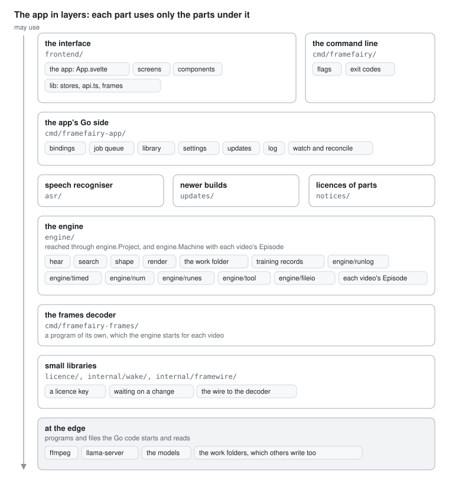
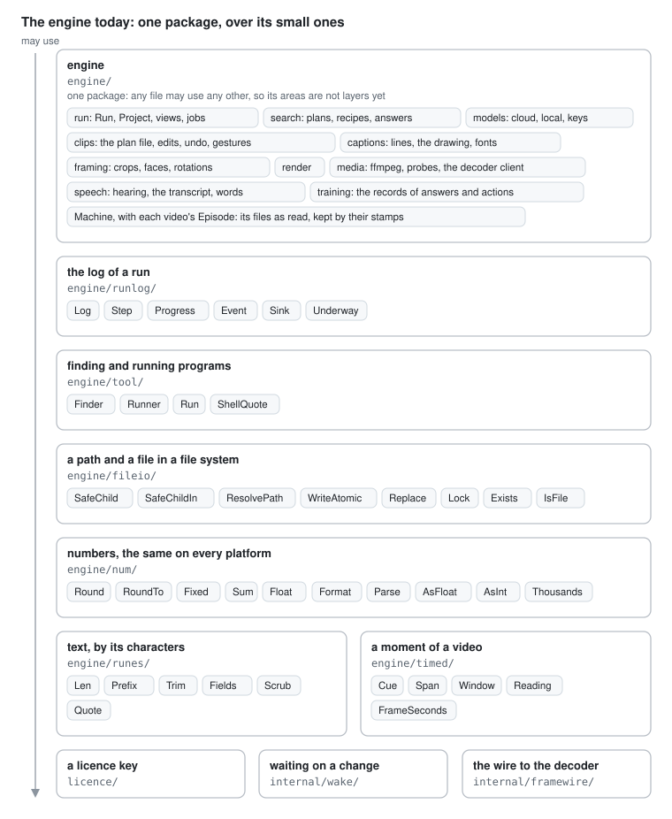
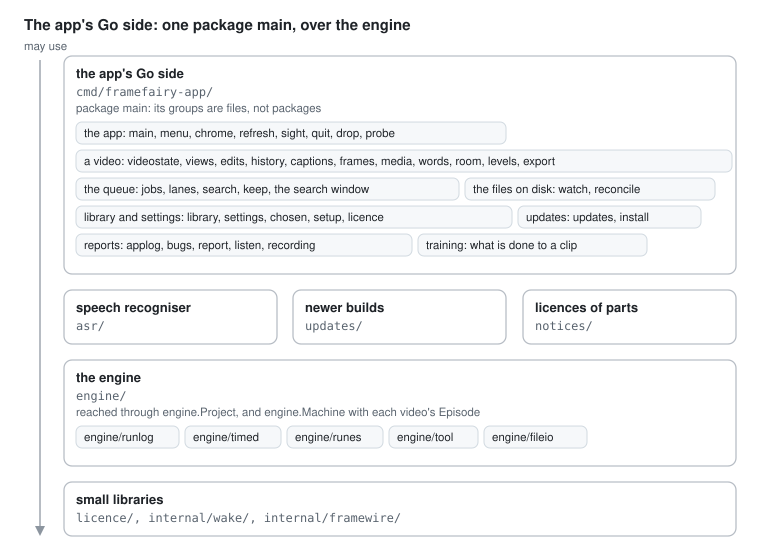
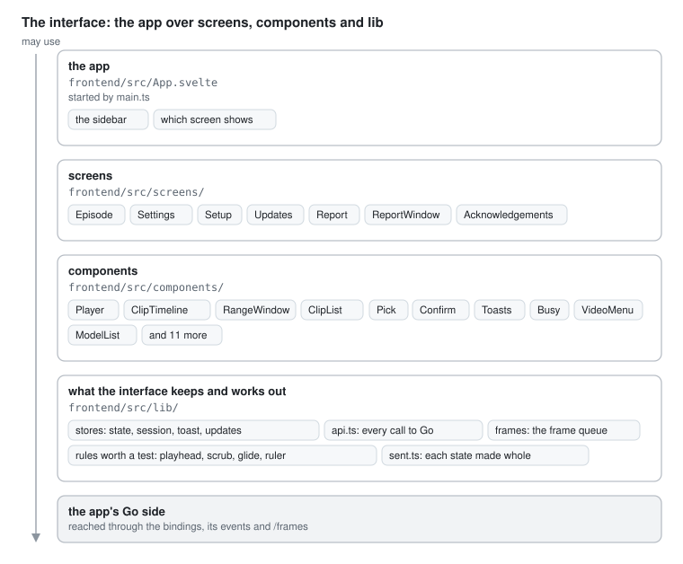

# Architecture

Where each kind of thing belongs in Frame Fairy, and what must stay true.
Read it before a change, and put the change where it says. It says
nothing about how a part works inside, that is the part's own doc. Its
shape is [matklad's ARCHITECTURE.md](https://matklad.github.io/2021/02/06/ARCHITECTURE.md.html),
short and only about what rarely changes.

A line is added only for a new kind of thing: a new part, a new home for
state, a new boundary. Such a change is simulated five times first, see
Changing the architecture at the end. A pull request that closes an
issue this file names rewrites the rows that name it and removes its
line under Not to copy. `internal/naming` checks that every path the file names exists.

## Bird's eye view

A part may use the parts under it and knows nothing of the parts over
it. That direction is the architecture: it decides where a piece of code
goes. A rule about a video belongs as low as it can go, in the engine,
where both front ends reach it. A rule found higher up, in the app or the
interface, is in the wrong place.

Inside the engine, a video goes through the same steps in both front
ends: it is heard into a transcript, searched into a plan of clips,
shaped by a person's gestures, and rendered into shorts. An edit takes
one path through the layers: the interface asks, a binding passes it on,
the engine works out the answer and saves it through `editPlan`, and Go
tells the interface what changed.

### Each part, one level down

The three parts with packages or folders of their own, drawn the same
way. Inside the engine and inside the app's Go side the groups are files
of one package, so nothing holds them apart yet.

The drawings are plain SVG in `docs/diagrams/`, a box a `rect` with its
texts and a chip a small `rect` with its text, and they follow the
reader's light or dark theme, on a background of their own. A change
that adds a part, moves a box, or changes what a box holds or how it is
reached changes its drawing in the same pull request, as the line it
changes in this file does.
`internal/naming` checks that every path a drawing names exists, written
from the top of the repository, and that every drawing shown here is
there.

## Code map

One row for each box of the top drawing that holds code, from the top,
with the boxes one level down under it.

| Layer | Code | Owns | Never holds |
| --- | --- | --- | --- |
| 1 the interface | `frontend/src/App.svelte`, started by `frontend/src/main.ts` | the sidebar and which screen shows | a screen's own layout |
| 1 | `frontend/src/screens/`, `frontend/src/components/` | layout and wiring | logic worth a test, which goes in `frontend/src/lib/` |
| 1 | `frontend/src/lib/` | what the interface keeps of what Go sent and of what the hand is doing, tested with Vitest. `frontend/src/lib/frames/` is the frame queue the video preview plays from | a rule of the engine, or a decision about a video's work. The rules still copied here are under Not to copy |
| 1 the command line | `cmd/framefairy/` | flags into `engine.Run`, and exit codes | a rule of its own |
| 2 the app's Go side | `cmd/framefairy-app/` | the bindings, the job queue and its lanes, the library and the settings, updates, the log | a rule of the engine. A binding asks the engine and passes the answer on |
| 3 | `asr/` | the speech recogniser. It implements `engine.Recognizer`, and each front end hands it to the engine | |
| 3 | `updates/`, `notices/` | finding, checking and fetching a newer build, and the licences of what the app is made of | |
| 4 the engine | `engine/` | every rule about a video: words, clips, edges, windows, captions, crops, rendering, the models, the files of a work folder, the training records | anything about the screen, a binding or a click |
| 4 | `engine.Project` | the steps one video takes, the same for both front ends | a second way to run a step |
| 4 | `engine.Machine` | what a program keeps for its whole life and shares with every `Engine` it makes: the files, the records, the `tool.Runner` and `tool.Finder`, the keychain, the network and the system's media engine it was handed, what was learned about the machine, and the one `engine.Episode` of each video, which keeps its own rules, made once in each `main` | what belongs to one job, which stays on its `Engine`, and a rule of its own |
| 4 | `engine/timed/` | the types every part of the engine uses for a moment of a video: a piece of text with its times, a span, a window, a loudness reading, the 10 ms grid of the sound | a function or a rule, and a type only one part uses |
| 4 | `engine/runlog/` | the log of a run: timestamped lines in the terminal, the progress line one piece of work can hold, steps with how long they took, and every line and progress as an event, which reaches the app through one `Sink` | a rule of a feature. A job says what happens and the log says it |
| 4 | `engine/tool/` | finding our own ffmpeg, ffprobe and llama-server, each checked against the sum `make` built in, by a `Finder` each program makes once, and running a program as an argument list, stopped once its work is called off, with how it stops held on a `Runner` | anything about a video, and a cache or a seam as a package variable |
| 4 | `engine/fileio/` | a path and a file in whatever `afero.Fs` it is handed: where a path really leads, whether a name stays inside its folder, a file replaced in one step, whether a file changed since it was read, and one edit of a file at a time, inside the program and across programs | anything about a video or a plan, and a cache or a seam as a package variable |
| 4 | `engine/num/` over `engine/runes/` | numbers rounded, summed, read and written the same on every platform, from JSON values too, and text counted, cut, trimmed and quoted by its characters, and scrubbed when it comes from outside | a rule of a feature, and anything about a file of a video |
| 5 the frames decoder | `cmd/framefairy-frames/` | turning a video into the frames, sound and captions of the video preview. The engine starts one for each video | anything but decoding. It is a child process |
| 6 small libraries | `licence/`, `internal/wake/`, `internal/framewire/` | the format of a licence key, how a waiter hears that something changed, and the wire between the engine and the decoder | |

Layer 7, at the edge, holds no code of ours: ffmpeg, llama-server, the
models and the work folders.

Outside the picture, not shipped in the app: `frontend/preview/` holds
the walks, in `frontend/preview/walks/`, which do what a person does
against the real Go side, in Chromium, and at night in WebKit too, see
[decisions/2026-11-05-walks-in-chromium-on-a-push.md](decisions/2026-11-05-walks-in-chromium-on-a-push.md),
and the harness they run in. `train/` and
`cmd/framefairy-train/` read the training records, `cmd/framefairy-release/`
and `licence/signer/` sign builds and keys, `licence/dispenser/` is the
licence server, and the rest of `internal/` holds the checks,
stand-ins and fixtures the tests share.

## Where state lives

Every piece of state has one home and one writer. A second copy is a bug
waiting for the day the two disagree.

| State | Home | Writer |
| --- | --- | --- |
| everything about a video | its work folder, `<video>.framefairy/`, the truth the app keeps in step with | the engine, and from outside the app the person in Finder, the command line and a sync service, which `reconcile` in `cmd/framefairy-app/reconcile.go` hears of through the watch on the disk, see the decision record [2026-11-01-the-app-in-step-with-its-files.md](decisions/2026-11-01-the-app-in-step-with-its-files.md) |
| what is chosen in a video, its clip and window | in memory, in the video's record beside its undo steps, `picked` in `cmd/framefairy-app/chosen.go`, behind a lock of its own, and written through to `chosen.json` in its work folder, which is read only the first time | the app's Go side |
| the library and the settings | the app's config folder | the app's Go side |
| the models, notes about running servers, the training records | `~/.framefairy/` | the engine, and for the models from outside the app the person in Finder, which `reconcile` hears of through the watch on the models folder and sends to the setup and the settings, see `tellSetup` |
| what a video's files said, as read: its transcript so far and its plans | the video's one `engine.Episode`, which `Machine.Episode` gives, `engine/held.go`. It keeps each read with the stamp of the files it was read from, `fileio.Stamp`, and reads again only what changed, whoever wrote it, see the decision record [2026-11-03-one-episode-per-video.md](decisions/2026-11-03-one-episode-per-video.md) | the engine, as the files are read. Nothing tells it a file changed |
| what was learned about the machine while a program runs: the decoder that works, the encoders and subtitle filter of each ffmpeg, the face detector, the tools already checked | `engine.Machine`, one for each program, in memory | the engine |
| what runs now, and the lane each job holds or waits for | the job queue, in memory | the app's Go side |
| the step a job is in, and what it was asked for | its `engine.JobRecord`, on disk and in the job the queue holds, which keeps each record the engine tells it through the job's `engine.Host` | the engine |
| how a job stands beyond its step: that it is stopping, how a search ended, how long removed work has left | the job the queue holds, `Stopping`, `Ended` and `Away` in `cmd/framefairy-app/jobs.go`, and the timer of each removal in the queue, see `removal.go` | the app's Go side |
| what is on screen | the interface's stores, and a video's status, clips, coverage, jobs, clip chosen and window in its `EpisodeSession`, `frontend/src/lib/session.svelte.ts`, which keeps the newest `VideoState`, and a hand's pick or move of the window until Go answers it | from what Go sends, and nothing else. What a hand pressed is kept by the job store until Go answers, see `startJob` |

## The programs that run

One app process holds the interface in the webview, WebKit on a Mac, and
the Go side, with the speech model in the same process. A panic on a
goroutine nothing recovers ends all of it. Wails recovers its
callbacks, a window's event, an event of the app, a call from the
window, and the app's `PanicHandler` logs them. It does not recover the
window's requests for frames, sound, captions and fonts, which
`mediaMiddleware` does. The engine starts the children that do a
video's work: one frames decoder for each video in the video preview,
ffmpeg and ffprobe for a render, a measure or a probe, and llama-server
for the local model, kept loaded. The app's Go side starts a few of its
own, for a recording, a report and showing a file in Finder. A cloud
model is reached with the person's own key.

## Where does it go?

What to do today, and what changes once the issue named is built.

| I need to | It goes |
| --- | --- |
| decide where an edge, a word or a window lands | the engine: `engine/shape.go` for a gesture, `engine.Episode` and `engine.Options` for a window. The interface asks and draws the answer |
| do something in the workspace when a video's work moves on | nothing in the interface: Go decides what follows and sends it in the video's state, the clip it chose and the window it fitted, in `cmd/framefairy-app/choose.go` and `window.go`, how a search ended, that work is stopping and how long removed work has left, and tells a failure once. The interface draws the newest state, and never waits for work to end to read the video again or keeps a value from before to compare, see [2026-11-01-every-rule-of-the-workspace-in-go.md](decisions/2026-11-01-every-rule-of-the-workspace-in-go.md) |
| show a press of a video's work before Go has answered it | `startJob` or `stopJob` of the job store, `frontend/src/lib/state.svelte.ts`, which keeps the press until Go answers with the job or says the work is stopping. Never a flag of the control's own |
| give a person time to take something back that Go then does | the job keeps the time, `JobAway` in `cmd/framefairy-app/removal.go`, on the queue's clock, which the bridge hands the walks, and the interface draws it and says only that a hand holds it |
| show the interface a new fact about a video | a field of `VideoState` in `cmd/framefairy-app/videostate.go`, or of what it holds, the status and the clip views, which the session keeps. Never a new event of its own or a poll |
| tell the window that something about a video changed | `told` on `*FrameFairy`, or the queue's `moved` for a job, which send the video's state, at most four times a second and always after the last change, one at a time, with at most one more waiting however slow a read is. Nothing else sends it |
| keep what a video's file said, so the next question does not read it again | its `engine.Episode`, by the file's stamp. Never a cache of its own in the app or a package variable |
| keep something between two jobs, a cache or a fact about the machine | a field on `engine.Machine`, in `engine/machine.go`, which a program makes once and hands to every `Engine`. What only the app keeps, a field of `FrameFairy` or of the part of it that uses it, ready as its zero value. Never a package variable, and never a new `Engine` made only to get it. The faces captions can be written in are `Machine.Fonts`, and a `Style` made from them carries them, so code that only has a style measures and installs through the right ones |
| let a test stand in for the system in the app: the keychain, the microphone, ffprobe, a download, Finder | a field of `FrameFairy`, or of the part that uses it, the system's own when it is empty. The test sets it on the app it made and runs beside the others. Never a package variable a test swaps |
| reach the keychain, a company or a model's download from the engine | through `engine.Machine`, whose keys and network are empty in a machine `NewMachine` makes, so it keeps no key and reaches nothing. Each program hands it the system's with `UseSystem` in `main`, the app through `appStore`, see the decision record [2026-10-31-running-programs-and-what-outlives-a-job.md](decisions/2026-10-31-running-programs-and-what-outlives-a-job.md#the-keys-and-the-network-648). Never a switch on whether a test is running. A part outside the engine that reaches the network, like `updates/`, is handed its client by `main`. llama-server on this machine is reached through the machine too, its client, its keys and the one server it keeps loaded in `engine/modelhost.go` |
| encode or decode through the system's own hardware, VideoToolbox on a Mac | through the machine's `engine.Media`, which `UseSystem` hands it in `main` and which is empty in a machine `NewMachine` makes, so a test's machine encodes and decodes with ffmpeg's own code on the processor. The episode's decoder is told by `-chip`, from `Machine.EpisodeFrames`, the one way to make one outside the engine. Whether to reach the media engine is never decided by `runtime.GOOS` where a video is encoded or decoded. Only `SystemMedia` reads the system, to say which media engine it has, and the decoder reads it only to know which kind of chip it was told it may use. The checks from outside the app take it away again, `LeaveTheMediaEngine` in the build only they use. See the decision record [2026-11-05-the-systems-media-engine-handed-in.md](decisions/2026-11-05-the-systems-media-engine-handed-in.md) |
| read a file of a video | through the `afero.Fs` the code was given, with `fileio.SafeChildIn` for a path in a work folder. Not `os`. A video's transcript, plans and status, through its `Episode`, and whether a path is the video's own, `Episode.Owns` and `Episode.HasPlan`. A view of a clip, a gesture or its captions, takes the plan the `Episode` holds. An edit reads the file itself, and `editPlan` again under its lock |
| change a plan | `editPlan` in `engine/edit.go` |
| notice a change made to a video's files, or to the models, outside the app | `reconcile` in `cmd/framefairy-app/reconcile.go`, which the watch in `watch.go` hands every change to, in a video's folders, its shorts, `Episode.Shorts`, and the models folder, and which runs once as the app starts, `watchTheDisk`, and as the library is read. Never a check of its own in a binding |
| tell the window that the models changed | `tellSetup` in `reconcile.go`, which sends `SetupState` whole on the `setup` event. The setup and the settings take it the way they take the answer of `Setup` |
| start a goroutine that runs code which can panic, like layout of words a person typed | a deferred recover where that work comes in, which turns a panic into that work's error and logs the stack where the work has a log, as `engine/planbuild.go` does. A goroutine that only waits, counts or hands on gets none. A parser of outside bytes has its fuzz target first |
| say that something went wrong | an error that keeps its kind with `%w`, returned to the caller. The app turns it into a row or a toast, and a job that fails is told once by the queue, a `Notice` from `cmd/framefairy-app/notice.go`, which the interface shows in a toast and never decides. It logs through `theLog`, never `log.Printf`, which forbidigo refuses. An engine the app makes outside a job logs through `engineLog(part, video)` in `cmd/framefairy-app/applog.go`, never to `io.Discard`. An engine is made for each job and takes its log then, and what outlives the job is on the machine it is handed |
| add a call between the interface and Go | a method on `*FrameFairy` in the file of its kind in `cmd/framefairy-app/`, and its call in `frontend/src/lib/api.ts`. `bindings_test.go` checks the name and the arguments |
| give the interface a new type or field | the Go struct and its interface in `frontend/src/lib/api.ts` in the same change. Once #611 is built, generated from the Go struct |
| add a setting | a field of `Settings` in `cmd/framefairy-app/settings.go`, changed through `UpdateSettings`. What the engine needs from it reaches it through its options |
| add a kind of work to the queue | a kind in `engine/jobs.go`, started with `addSteps` in `cmd/framefairy-app/jobs.go`, so it gets the lanes, the recover and the record every job has |
| copy a rule of the engine into TypeScript | don't, and no `.cases.json` makes it right. The interface asks Go, or reads the answer from the state. Where it must answer while a hand drags, Go sends what the drag needs as data, see [2026-11-01-every-rule-of-the-workspace-in-go.md](decisions/2026-11-01-every-rule-of-the-workspace-in-go.md) |
| add a check to CI | a make target, and its rule in `scripts/changed.sh` with its case in `scripts/changed-test.sh`, see BUILD.md |
| fake something in a test | the clock, the disk, the models and the system's media engine are handed in. Use the fakes there are, in `engine/project_test.go` and `internal/standin/`. What the media engine is handed is checked as an argument list against a stand-in ffmpeg, never by running it |
| give a test a video or a sound | a file committed in `internal/fixtures/testdata/`, read with `fixtures.Path`, or copied with `fixtures.Copy` by a test that changes it or writes beside it, or with `fixtures.CopyTo` where nothing can end the test, like a route a walk calls, made by its recipe in `internal/fixtures/fixtures_test.go`. One that is there before a new one, see the decision record [2026-11-01-committed-test-fixtures.md](decisions/2026-11-01-committed-test-fixtures.md). Never made by ffmpeg while the test runs |

## Invariants

What must stay true, and what holds it: a check in CI, or the review,
which reads this file.

1. The engine knows nothing of the layers over it. `engine/` imports
   nothing from `cmd/`, which Go refuses anyway, nor from `asr/`, and
   `engine/runlog/`, `engine/tool/`, `engine/fileio/`, `engine/timed/`,
   `engine/num/` and `engine/runes/` nothing of the rest of the engine.
   Among them `engine/runlog/` uses `engine/num/` and `engine/runes/`,
   `engine/num/` and `engine/fileio/` use `engine/runes/`, `engine/tool/`
   uses none of them, and none uses one above it. Held by Go's imports,
   which refuse a cycle, and by the review for the rest.
2. One engine, two front ends. A rule lives once, in the engine. Held by
   the review.
3. One word model. What a video says is `Transcript.Words`, and what a
   clip shows is made from it. A clip keeps no words, see
   [WORDS.md](WORDS.md). Held by the review.
4. One drawing of the captions, by libass, from `CaptionTrack`, see
   [CAPTIONS.md](CAPTIONS.md). Held by the review.
5. The files on the disk are the truth about a video, and others than
   the app write them. Go is the one that reads them for the interface,
   and the interface shows what Go sends. A change from outside lands in
   `reconcile` and nowhere else. Held by its design: a video's jobs and
   everything they change reach the window only in its `VideoState`, the
   session keeps the newest, the cards on their way come from the jobs
   of the state the clips come from, and the interface keeps nothing of
   a video's work but a press Go has not answered yet. How long a row
   that says what became of something stays on screen, a clip removed by
   hand or a search that found nothing, is the interface's, like a
   toast's: it is how the news is shown, not what happened to the work.
   And by the watch,
   see [the decision record](decisions/2026-11-01-the-app-in-step-with-its-files.md),
   and by the review.
6. A job that goes wrong fails itself, not the app. Held by a recover
   at each place work comes into the Go side: around every job, every
   request of the window in `mediaMiddleware`, every callback of Wails
   through the app's `PanicHandler`, and every goroutine of ours that
   reads what nobody checked.
7. Nothing is learned twice. What outlives a job is kept, not worked out
   again for each job. Held by `engine.Machine`, which each program
   makes once and hands to every `Engine`, and by `FrameFairy` for what
   only the app keeps.
8. Every path is judged by where it really leads, inside the library.
   Held by `SafeChild` in `engine/fileio/`, each video's
   `engine.Episode`, `Owns` and `HasPlan`, which the store's `Known` and
   `PlanOf` ask, and their tests and fuzz targets.
9. What comes from outside is read by code made for it, never parsed on
   the way: a model answer by the stream readers in `engine/stream.go`,
   `ExtractJSONObject` and `ValidatePlan`, a plan by `LoadClips`, a
   transcript and a job's record by their readers in `engine/transcript.go`
   and `engine/jobs.go`, a path by `SafeChild`. Held by their fuzz
   targets.
10. A test waits on a signal, never on the clock, and stays off the disk.
    Held by forbidigo in `make lint` and by `internal/offdisk`.
11. A test reads its video or sound from a committed fixture, never makes
    one while it runs. Held by `TestNoTestMakesItsOwnFixture` in
    `internal/ffmpegtest`, and by `TestEveryFixtureIsMadeByItsRecipe` in
    `internal/fixtures`.
12. No test reaches the system's media engine. A machine is handed it in
    each program's `main`, and one a test makes has none, so a render,
    framing and the episode's decoder run ffmpeg's own code on the
    processor. Held by `UseSystem` being the one place that hands it, by
    `Machine.EpisodeFrames` being the one way to make the episode's
    decoder outside the engine, and by
    `TestOnlyAMachineHandedTheMediaEngineReachesIt`.

## Boundaries

Where one layer meets another. A change to one of these changes what the
other side relies on, and the pull request says so.

- The bindings on `*FrameFairy` and `frontend/src/lib/api.ts`.
- The `video` event, `VideoState`, whose `rev` is on the clock of the
  jobs' `seq`, so the window can tell which of two came later. It is the
  one way a video's jobs reach the window, and it holds every job of the
  video there is to say anything about. The `job` event carries only a
  job of no video, a model being downloaded, see `toWindow`.
- The `notice` event, `Notice`, a failure told once as it happens, which
  is no fact of a video's state.
- `engine.Project`, the steps a front end may take.
- `engine.Episode`, with `engine.Options` handed in, the questions a front end asks of a video's files: its transcript, plans, status, room and window, and whose a path is.
- The files of a work folder and of the config folder, which an older
  and a newer build both read, `chosen.json` and the settings among
  them, see #612.
- `internal/framewire` and the decoder's one argument besides the episode, `-chip`, between the decoder and the engine.
- The update feed and the licence key, which the builds of customers
  read.

## Not to copy

Code that breaks this map today, with the issue that fixes it. A session
copies what it finds nearby, so these are not the pattern for new code.

- Rules of the engine in `frontend/src/lib/flow.ts` and
  `frontend/src/lib/rotate.ts`, and the two held to Go by a shared case
  file, `frontend/src/lib/glide.ts` and `frontend/src/lib/flow.ts`'s
  frames, #610.

## Changing the architecture

A change to how the code is organised or designed is worked through five
times before any code, and the five converge on one. It is a change that
decides something this file records: a package, a layer, a home for
state or a boundary added, removed, split or joined, or a type moved
between packages. Rewording a row is not one. Carrying out a design a
decision record already holds is not one either, it names that record.
When in doubt, do the five.

1. **Five simulations.** Each is a candidate design from a principle of
   its own, worked through on the code as it is, as if it were built: the
   layers it gives, what moves where, the names that would cross each new
   boundary, counted from the code and not guessed, the next likely
   changes and what they would touch, and the cost in files and pull
   requests. Five variations of one idea are one simulation. Five
   principles make a good start: who may know about whom, what changes
   together, where state lives, what runs together, and what a test has
   to build.
2. **They converge.** What comes back in most of them is kept, what only
   one needs is dropped or kept for a reason that is said. The final
   candidate is drawn as layers, each using only the ones under it, the
   way `docs/diagrams/` draws them.
3. **It is written down** as a decision record in `docs/decisions/`,
   pushed with the first code of the change, see
   [decisions/README.md](decisions/README.md). A change made over several
   pull requests has one record, in the first, and the others name it.
4. **The review agent gets the record** and reasons through the five
   itself before it reads the verdict, see the review skill.
