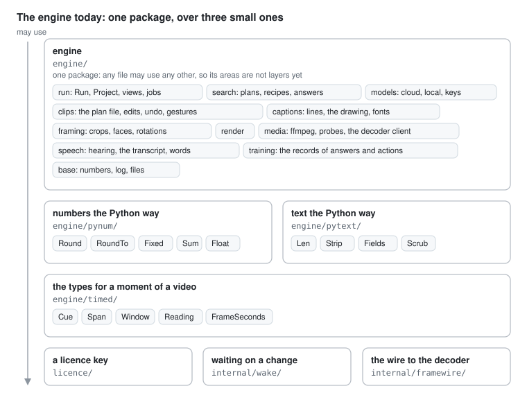

# Numbers and text the Python way get packages of their own

Step 1 of splitting the engine into packages, after `engine/timed`
(#621). Decided on 30 October 2026, in the pull request that makes it.

## The problem

Tim asked for the engine to be split into packages that follow the map
in [ARCHITECTURE.md](../ARCHITECTURE.md), one step at a time, and said go
on this order on 30 October. The first part to stand alone, framing,
cannot move while it uses helpers that live in the engine.

The helpers in `engine/util.go` are that first obstacle. Measured on
main at b22df65 with the type checker, over the files of `engine/`:

| Helper | Uses | Areas that use it |
| --- | ---: | ---: |
| `fixed`, a number with n decimals | 104 | 9 |
| `roundTo`, Python's round(x, n) | 71 | 9 |
| `Scrub`, text made safe to print and store | 52 | 8 |
| `PyFloat`, a float written to JSON as Python writes it | 31 | 2 |
| `runeLen`, Python's len() on a str | 28 | 5 |
| `pyround`, Python's round(x) | 25 | 3 |
| `toFloat`, `toInt`, a number read from a JSON value | 39 | 7 |
| `pyStr`, `pyRepr`, `pyListRepr`, a value written as Python's repr | 38 | 5 |
| `strip`, `fields`, `isPySpace`, Python's whitespace | 26 | 8 |
| `isFinite`, `pysum`, `parsePyFloat`, `pyFloatRepr`, `runePrefix` | 35 | 6 |
| `shellQuote`, a command written for a shell | 4 | 3 |

Every area of the engine uses some of them, and `util.go` changed once in
the 149 commits to `engine/` since the app was brought over. So they are
used by everything and change with nothing.

## Five simulations

### 1. Who may know about whom

All of `util.go` becomes one package at the bottom of the engine, under
every area, named for what it is, the Python version's behaviour. It
exports 20 names, and every area that moves later finds them under it.
One pull request, 45 files, 453 uses. But it mixes four kinds of thing,
and the reading of a plan's JSON values in it belongs to the plan file,
which step 4 moves. A package that holds whatever is shared is the
`util` package Go's own advice warns about.

### 2. What changes together

The helpers changed once in a month, so history cannot group them. Their
names do: numbers (`fixed`, `roundTo`, `pyround`, `pysum`, `isFinite`,
`PyFloat`, `pyFloatRepr`, `parsePyFloat`), text (`runeLen`,
`runePrefix`, `strip`, `fields`, `isPySpace`, `Scrub`), values read from
and written to a plan's JSON (`toFloat`, `toInt`, `pyStr`, `pyRepr`,
`pyListRepr`), and the shell (`shellQuote`). Four groups, each going
where its kind belongs: numbers and text to the bottom now, the values
with the plan file in step 4, the shell with running programs in step 3.

### 3. Where state lives

The helpers hold no state, but some decide how state is written: `pyStr`,
`pyRepr` and `toFloat` read and write the values of a plan file, which has
one home and one writer. They belong with the plan file. `PyFloat` is used
only to write transcripts and plans, by speech 19 times and search 12,
but a float written the Python way is a number format any file may need,
so it stays with the numbers. What is left, numbers and text, holds no
state and can sit under everything.

### 4. What Go already has

Four helpers are one line over the standard library: `runeLen` is
`utf8.RuneCountInString`, `fixed` is `strconv.FormatFloat(x, 'f', n,
64)`, `pyround` is `int(math.RoundToEven(x))`, `isFinite` is two `math`
calls. Inlining them removes 173 uses from any package. But `fixed`
alone is 104 places where a short name would become a long call, and the
names say why they exist: the Python version counted characters, not
bytes, and rounded halves to even. Inlining hides that reason at every
call. It is worth it for none of them.

### 5. What a test has to build

Framing, step 6, has to build without the engine. It uses `fixed`,
`roundTo`, `pyround`, `pysum`, `isFinite`, `parsePyFloat`, `Scrub`,
`runeLen`, `strip`, `fields`, `toFloat` and `toInt`. Whatever the split, those must sit under framing by
then: numbers and text in step 1, the JSON values in step 4. A test of
the helpers themselves builds nothing, so each package's tests run in
milliseconds alone.

## What converges

- The helpers go under every area: 1, 2, 3 and 5.
- Numbers and text are two different things: 2, 3 and 4 group them so.
- The plan's JSON values go with the plan file in step 4, not now: 2, 3
  and 5.
- `shellQuote` goes with running programs in step 3: 2 and 3.
- The names stay short and say they follow Python: 1 and 4.

Only simulation 1 keeps everything in one package, and only 4 inlines.

## The decision

Two packages at the bottom of the engine, beside `engine/timed`:

- `engine/pynum`, numbers rounded, summed and written the way the Python
  version did: `Round`, `RoundTo`, `Fixed`, `Sum`, `IsFinite`, `Float`,
  `FloatRepr`, `ParseFloat`.
- `engine/pytext`, text counted, cut and trimmed the way the Python
  version did, and scrubbed before it is printed or stored: `Len`,
  `Prefix`, `Strip`, `Fields`, `IsSpace`, `Scrub`.

The JSON values and `shellQuote` stay in `engine/util.go` until steps 4
and 3. `pynum` and `pytext` were checked as names: neither is used for
anything else in the engine, where `num` and `text` are common local
names.

## What follows

- It costs one pull request of renames, about 370 uses in about 40
  files, done by the type checker like #621.
- It buys the first of the four groups that block framing, and an area's
  numbers and text now come from one place it can see.
- It was wrong if a later step has to reach back into `pynum` or
  `pytext` for something only one area uses, or if the plan file in step
  4 needs `PyFloat` moved again.
